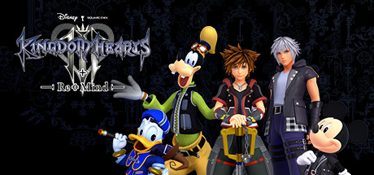

**Kingdom Hearts III is the epic conclusion to the Dark Seeker saga, sending Sora through stunning Disney worlds to gather the Power of Waking and stop Master Xehanort's endgame. Features the most fluid combat and biggest set-pieces in the series.**

---

## 📖 About

Kingdom Hearts III is the epic conclusion to the Dark Seeker saga, sending Sora through stunning Disney worlds to gather the Power of Waking and stop Master Xehanort's endgame. Features the most fluid combat and biggest set-pieces in the series.

## ⚠️ Problems Without Trainer

| Problem | Status |
|---------|--------|
| **Keyblade Grind** — Leveling all Keyblades to max requires extensive material farming | ✅ Solved |
| **Story Complexity** — Requires knowledge of multiple previous games to follow plot | ✅ Solved |
| **Gummiship Segments** — Space shooter sections feel disconnected from main gameplay | ✅ Solved |
| **Critical Difficulty** — Critical mode punishes any mistake brutally even for veterans | ✅ Solved |

## ✅ Solution

The **KINGDOM HEARTS III Trainer** solves all these issues by giving you complete control over the game.

## 🎯 Full Feature List

- Unlimited Resources
- God Mode / Invincibility
- Instant Skill Cooldown
- One-Hit Kill
- Freeze Game Timer
- Unlock All Items & Achievements
- Custom Speed Multiplier
- Save State Anywhere

## 🚀 Quick Start

1. **Disable Windows Defender** temporarily (trainer may trigger false positive)
2. Download the trainer from the button above
3. Launch KINGDOM HEARTS III
4. Run the trainer as Administrator
5. Activate desired cheats with hotkeys

## 💎 Free vs Paid

| Feature | Free | Pro |
|---------|------|-----|
| Basic God Mode | ✅ | ✅ |
| Unlimited Resources | ✅ | ✅ |
| All Advanced Cheats | ❌ | ✅ |
| Auto-Updates | ❌ | ✅ |
| Priority Support | ❌ | ✅ |

## 💻 Requirements

- Windows 10/11 (64-bit)
- KINGDOM HEARTS III (any version)
- .NET Framework 4.8+
- DirectX 11+

## 🍎 macOS

macOS users can use our alternative tool:

## ⚖️ Legal

This trainer is for educational and single-player use only. Use responsibly.

---

